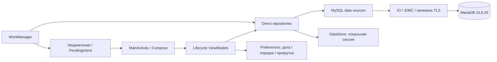

# Итоговый инженерный аудит FFL Driver Direct

Дата: 17.10.2026. Версия: **0.2.2-dev**, versionCode **4**, applicationId `ru.ffl24.direct.dev`.
Окончательная оценка и артефакты: [RELEASE_READINESS](RELEASE_READINESS.md).
Фактические результаты каждого запуска: [FINAL_TEST_RESULTS](FINAL_TEST_RESULTS.md).
Незакрытые ограничения: [REMAINING_RISKS](REMAINING_RISKS.md).

## Область и сохранность

Проверен независимый проект `/workspace/FFL-direct`: один модуль `:app`, 49 основных Kotlin-файлов, Gradle, manifest, ресурсы, SQL, тесты и инструменты восстановления. Использованы BACKEND_CONTRACT_REPORT, DIRECT_DB_CONTRACT, DIRECT_UI_CONTRACT, DIRECT_REWRITE_PLAN, PROGRESS, RESTORED_DATABASE, исходники reference Android/backend и настоящая восстановленная MariaDB. Прежние отчёты не принимались за новый запуск.

До правок сохранены SHA 611 файлов Direct и Git status/HEAD обоих reference-проектов: `evidence/final-audit/before.json`, `preservation-before.json`. Direct не является Git-репозиторием; новый Git/worktree/commit/push не создавался. Старые APK/ZIP и исторические evidence сохранены. Финальная сверка файлов приведена отдельно в `files.md` и `validation.json` этого аудита.

Дамп пользователя и реквизиты находятся вне checkout. Полная БД доступна только в собственной Docker-копии через loopback. Production-подключения, production DDL/UPDATE и реальные звонки не выполнялись. Инструкции вложенного задания использованы как объём запрошенной работы; наличие команд в restore kit само по себе не было разрешением воздействовать на внешние серверы.

## Конечная архитектура

Реальная цепочка: `DirectApplication.graph` создаёт `AppGraph` из BuildConfig; `DirectApp` использует SetupAuth/Workspace/OrderDetails ViewModel; repositories получают водителя из AuthSessionManager; data sources выполняют PreparedStatement через Connector/J. MainActivity не принимает адрес БД/backend от пользователя. Единственный RuntimeMode — DIRECT_MYSQL; неизвестное значение не переключает транспорт.

В runtime-графах debug/release запрещены Retrofit, OkHttp, Ktor, JWT и MySQL Connector/J. Используется закреплённый MariaDB Connector/J 3.5.10, без FastAPI и HTTP fallback. Ссылки HTTP/HTTPS служат только внешней навигации. Legacy FFL/backend остаются reference-проектами, не сервисами Direct.

Конфигурация автоматически включается при developer-сборке из приватного окружения. Публичный APK имеет семь пустых DB-полей и показывает «Подключение не настроено» без формы backend IP. Настроенный APK содержит извлекаемый локальный DB-пароль и не включается в выдаваемые архивы. Эти два артефакта нельзя подменять друг другом в отчёте.

## Найденные проблемы и исправления

| ID / серьёзность | До исправления | Изменение / доказательство |
| --- | --- | --- |
| A01 — высокая | Повторные SELECT access в транзакции REPEATABLE READ видели старое access=1 после отзыва | Первый SELECT access выполняется с LOCK IN SHARE MODE до блокировки заказа; shared lock держится до commit/rollback. На реальном сервере воспроизведён старый snapshot; новый Android-тест проверяет блокировку конкурирующего locking read и освобождение после commit |
| A02 — высокая | Worker restore мог повысить revision между logout invalidate и disk clear: clear пропускался, старый hint мог восстановиться | Restore стал наблюдением текущей revision. Login/logout запрещают восстановление с диска до ожидания storage. Два restore не отменяют друг друга. Четыре детерминированных теста на прежнем коде провалились; добавлена проверка offline hint/retry |
| A03 — средняя | Superseded login/restore выбрасывал CancellationException при живой coroutine; UI мог остаться Loading/busy | При смене identity возвращается безопасный AuthResult.Failed; настоящая coroutine cancellation продолжает распространяться. Проверяется отсутствие публикации устаревшей сессии |
| A04 — высокая | Legacy collation принимала пароль с другим регистром и хвостовым пробелом | `BINARY parol = BINARY ?`, без проекции пароля, изменения схемы или хранимых значений. Это намеренное усиление относительно backend SQL. Host SQL и Android repository проверяют exact/wrong/empty/case/trailing/injection/unknown-driver |
| A05 — средняя | Запрос адресов выполнялся отдельно для каждого distinct номера | Ограниченные пакеты по 64 параметра; серверный JOIN сохраняет TRIM/collation matching. Выбор кандидата выполняется заново для каждой строки/name_c, ambiguity не разрешается tie-break. На реальном наборе сверены все candidate IDs |
| A06 — низкая | Список схлопывал внутренние пробелы номера, детали/backend сохраняли их | Единый orderNumber: trim краёв, сохранение внутренних пробелов, «Без номера» для пустого значения |
| A07 — средняя | TLS/refused-connection/подтверждённый rollback показывались как неизвестная запись; ServiceLoader Error не обрабатывался | Определённые сбои возвращают safe error. UNKNOWN остаётся для неопределённого commit/rollback и таймаута; автоматического повтора нет. Реальный обрыв после UPDATE проверяется отдельно |
| A08 — средняя | Разные экземпляры Preferences/Worker могли одновременно прочитать старый seen и повторно определить один ID новым | Общий process mutex и атомарный read/merge/commit в observeSecondRoute. Два независимых экземпляра одновременно наблюдают новый ID только один раз. Перед post повторно сверяются session/opt-in/date |
| A09 — низкая | Горизонтальные группы кнопок неудобны при узком экране/крупном шрифте; стрелки не имели описания действия | FlowRow переносит toolbar/actions, добавлены «Поднять заказ»/«Опустить заказ». Проверяются 320dp, светлая тема и тёмная с fontScale1.6, доступность и горизонтальные границы кнопок |
| V01 — средняя | Визуальный просмотр показал разрывы «Первый»/«Сданные» посреди слов при fontScale1.6, хотя исходный тест границ проходил | Разделы перенесены в FlowRow с labelMedium; Android-тест проверяет line boundaries каждого названия, screenshots просмотрены после полного прогона |
| V02 — средняя | Indigo primary на тёмном surface давал контраст текстовых кнопок только2.84:1 | Тёмный primary использует имеющийся lavender цвет, onPrimary — тёмный текст. Контраст11.97:1; runtime ColorScheme проверяется для текстовых и заполненных кнопок в обеих темах |
| A10 — высокая | Helper выдавал приложению SELECT на все101таблицу | SELECT ограничен семью контрактными таблицами, EXECUTE name_v и UPDATE двух delivery columns сохранены. Отдельный TLS read-only auditor проверяет целостность и BF только в test configuration, не в Main APK. На новой роли повторены все11 restored Android methods; unrelated table read запрещён |
| A11 — критическая для release | Успешно собранный R8 APK падал до MainActivity: удалён no-arg constructor WorkDatabase_Impl | Добавлено узкое keep-правило конструктора generated Room DB WorkManager. Остальная минификация сохраняется. Независимая framework-only Java instrumentation проверяет обычный release runtime, без debug Kotlin/AndroidX оснастки; итоговый результат — FINAL_TEST_RESULTS |
| T04 — инфраструктура тестов | Повторный reset paired fixture встречал duplicate BF row до начала следующего test method | Reserved BF marker удаляется до UPDATE исходного fictional заказа и после trigger. Исходные trigger bodies не менялись. Первый запуск остановился после4успешных методов; новый полный11-case прогон завершился успешно |
| T05 — инфраструктура release-теста | Debug androidTest ссылался на Kotlin/AndroidX классы, переименованные R8; затем accessibility click опережал enabled state | Отдельная Java оснастка зависит только от Android framework, ждёт доступную enabled кнопку, завершение перехода и visible target OR scrollable container, проверяет UI и независимо SQL post-state. Старые попытки не засчитываются |
| T01 — инфраструктура тестов | Возврат из деталей проверял display до завершения lifecycle refresh/placement | Ограниченное ожидание именно displayed-состояния, прежний assertion сохранён. Первая ошибка остаётся в evidence |
| T02 — инфраструктура тестов | Диалог ANR System UI перекрыл focus/clipboard на software AVD | Зафиксирован системный overlay, на собственном эмуляторе выбран Wait; не объявлялось успешной проверкой приложения. Итоговый suite запускается повторно |
| T03 — достоверность артефакта | Collector считал hash файла в конце запуска; параллельная новая сборка могла заменить файл на диске | Hash фиксируется до установки, installed base.apk отдельно сверяется. Первый installed hash восстановлен до следующей установки; исправление metadata и исходный ошибочный hash сохранены |

Гонки сессии исправлены без хранения пароля в StateFlow/DataStore и без доверия локальному ID как серверной аутентификации. Disk hint после сетевой ошибки допускает только новый access SELECT; после login/logout/disabled он не даёт автоматического восстановления в текущем процессе. Неустранимый случай отказа storage после logout/перезапуска описан в рисках.

## Аудит SQL и схемы

Фактический сервер — MariaDB 10.6.25, InnoDB для auth, обеих таблиц заказов и связанных log/BF. Версия совместима с core исходного дампа; пакет контейнера отличается от cPanel-пакета источника. Функция name_v вызывается, допускает NULL для исторического отсутствующего водителя. Структура/индексы не менялись. В этом аудите выполнен ещё один полный чистый импорт того же gzip в отдельный owned container19068. Новый baseline без исключения строк:101таблица/359,540строк. Он независимо совпал с прежним baseline; вспомогательная копия удалена после измерения, основной volume сохранён. Streaming SHA SQL при импорте совпал с исходным52,606,346bytes.

| Группа запросов | Проверенные условия |
| --- | --- |
| getDrivers | __hr_typepos; access=1; name not null/<>''; сортировка; parol не выбирается |
| login/checkAccess | Параметры driver/password; точный пароль; empty/invalid driver до login SQL; нет приведения мусорного/fractional access в 1; повторная проверка после password lookup |
| orders | UNION ALL reys/reys_den; обязательные date/id_v на обеих ветвях; source enum; Long IDs; SQL order st_vv/section/sort_r/id; NULL числовых полей как 0 |
| contacts | JOIN запрошенных значений с TRIM(nomer_z), LEFT JOIN manager; server collation сохранена; не кешируется готовый выбор по номеру |
| details/owner | id+id_v, allowlist source; чужой и отсутствующий заказ не различаются; без скрытого date filter; access до/после и ownership перед выдачей |
| history | Та же source-table, исходный name_c, более ранняя date, id<>current, date/id DESC LIMIT5; inactive исторические водители не удаляются |
| directory | MAX karta/imya_karta; phone blank skip; active driver mobile→whatsapp; raw номера сохраняются; операции read-only |
| summary | Оба источника/date/driver; delivered ровно st_vv==1; активные second source IDs с sort_r/id; два SELECT не обещают единый snapshot |
| deliver | Shared access lock, SELECT order FOR UPDATE id/id_v, UPDATE только st_vv/date_att_log, affected rows=1, post-read, commit; repeat без UPDATE; rollback/UNKNOWN |

Все пользовательские значения передаются параметрами. Интерполяция таблиц допускается только через закрытый OrderSource enum; число placeholders контактов ограничено 1..64. SQL/password/phone/address/driver DTO не выводятся в пользовательские ошибки. Resource scope закрывает ResultSet/Statement/Connection. Query/connection исключения переводятся в enum; vendor logging отключён до инициализации драйвера.

Реальные исходные записи используются read-only. Все write/concurrency/fault tests ограничены заранее свободными fictional IDs/prefix в восстановленной копии. Исходные triggers не отключены: они могут аудитить/синхронизировать reys_bf. Проверяется rollback также связанной BF строки; утверждение «клиент SET двух полей» не означает отсутствия серверных side effects.

## Производительность и lifecycle

Базовый lookup для 39 реальных номеров: 39 запросов, медиана 7.786мс. Пакетный: 1 запрос, те же candidates, медиана 2.272мс, пять samples. Это loopback host SQL, без задержек Android/мобильной сети. Не выдаётся за время открытия экрана. EXPLAIN и samples — `sql-audit-and-performance.json`.

У order date/id_v нет подходящего составного индекса; contact TRIM мешает обычному index lookup. Приложение уменьшает сетевые round trips без DDL. Предложения DBA: EXPLAIN/нагрузочный замер составного `(date,id_v)`/`(id_v,date)` и варианта history `(name_c-prefix,date,id)` с учётом TEXT, а также серверного нормализованного ключа контакта. Такие изменения требуют отдельного анализа selectivity, storage и legacy writers; в аудит не применялись.

JDBC работает через Dispatchers.IO/runInterruptible, общий Semaphore2. Политика: connect3с/socket5с/query3с/coroutine budget15с. Это не гарантия жёсткой отмены каждого native DNS/driver call ровно за15с. Слепых write retries нет. Lifecycle скрывает protected content в фоне, отменяет чтения, делает access check на foreground; UI собирает StateFlow с lifecycle. Адрес перед внешним переходом повторно читается и проверяется owner.

Стабильность software API30 проверяется фактическими suites, а не отсутствием видимого падения. ANR/heap leak-free/60fps на физических телефонах этим не доказаны. Дополнительно minified cold am start -W завершился Status ok, TotalTime6121мс; ранний PSS32828KiB. Это диагностика TCG, не время готовности всех данных, не steady-state или production benchmark; heap leak не проверялся.

## UI и внешние действия

Сохранены согласованные три раздела, компактные строки, long-press drag/стрелки, локальный driver/date/section order, прокрутка, дата, темы, детали и справочник. Ready guard не снят: в списке остаётся пятисекундное подтверждение, в деталях обычный confirm. Resolver при ambiguity не показывает случайный адрес/контакты; manual mode не подставляет destination.

Сравнение с прежним UI выполнено по исходникам/контракту и [UI_PARITY](direct-rewrite/UI_PARITY.md). Старый API UI с одинаковым набором данных не запускался; pixel-perfect сравнение не заявляется. Актуальные screenshots — только fictional records. Clipboard и построение Intent проверяются отдельно от настоящих Яндекс-приложений/телефонного вызова.

ACTION_DIAL не требует CALL_PHONE и не совершает звонок. Route Intent ограничен четырьмя схемами после URI validation и явным пакетом Яндекс Карт/Навигатора; javascript/intent/file/content не принимаются. MainActivity exported для launcher, notification driver сравнивается с текущей сессией. Сторонний Intent не задаёт произвольный SQL source/driver.

## Уведомления и безопасность

WorkManager — polling>=15мин, без обещания push/непрерывного канала. Первый ответ baseline, seen source IDs сохраняются до post; crash между commit seen и notify может потерять уведомление. Notification текст общий, PendingIntent immutable, tap открывает второй рейс после access gate. Отмена работы Android асинхронна; worker повторяет session/opt-in/date проверки.

TLS explicit CA+hostname, verify-full, TLS1.2/1.3, без fallback/system trust/redirect/public-key retrieval. Cleartext запрещён в manifest, но JDBC socket защищается именно TLS plugin, не одним manifest flag. Root/admin не встроен в APK. Избыточный общий SELECT убран: приложение читает только7контрактных таблиц; все101таблица доступны только отдельному audit account вне Main BuildConfig. Это уменьшает область раскрытия, но не даёт изоляции по водителю. Backup/transfer exclusions заданы; OEM/физический backup отдельно не проверен. Release R8 не делает встроенный password секретным.

**Серверной изоляции водителей нет.** На actual account повторно доказаны чтение parol/чужих строк и разрешённый UPDATE чужого fictional заказа в обход клиента. Probe откатан. Отказы UPDATE auth/status, INSERT/DELETE подтверждены, но column grants не являются row authorization. Этот аудит не объявляет Direct пригодным к распространению настоящим водителям.

Полный перечень оставшихся рисков и вариант серверной проверки без отдельного VPS — [REMAINING_RISKS](REMAINING_RISKS.md).

## Изменённые файлы и проверка сохранности

Полный список изменённых файлов кода/tools/docs и SHA текущих файлов формирует [files.md](evidence/final-audit/files.md) / validation.json; новая директория evidence перечисляется отдельно. Main changes: AuthSessionManager, DirectAuthRepository, DirectMySqlDriverDataSource, DirectDeliveryDataSource, DirectWorkspaceDataSource, WorkspacePreferences, SecondRouteNotifications, DriverOrdersScreen, Theme, app build/proguard. Tests: session/failure/SQL acceptance, Android AuditDatabase/Layout/Preferences, restored flow и bounded navigation check. Tools: dev_database, integrity checker, public Android runner, независимый Java R8 harness/runner, evidence validator. Старые рабочие runtime/артефакты не удалялись.

Финальный валидатор требует843/29/11/2свежих PASS, отсутствие API dependencies и DB config в public APK, текущий R8 keep rule/build, SQL/gzip hashes, все104reference hashes и clean legacy Git status. Проверяет5приватных DB passwords без вывода значений. Public archive отдельно проверяется CRC, побайтовым соответствием entries и отсутствием дампа/keys/configured APK. Результат готовности: DEVELOPER_TEST_READY, driver rollout блокируется архитектурным security риском.
