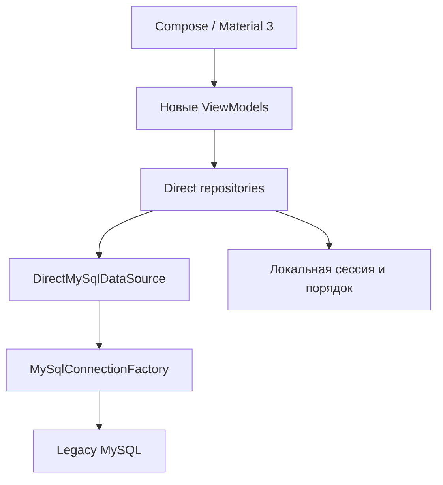

# FFL Driver Direct — контекст 0.2.0-dev

## Актуализация19.10.2026 — UI и runtime Direct MySQL0.3.1

Пользователь разрешил отдельный DB-редактор вместо прежнего BuildConfig-only flow. Реализованы утверждённый Compose-дизайн, пять действий панели, ручная локальная сортировка и административные check/save/TLS/Keystore/переключение профиля. Старые ограничения на DB-форму ниже исторические; API backend IP не возвращён.

## Итоговые проверки 0.3.1 — 19.10.2026

| Проверка | Результат |
| --- | --- |
| Debug APK + AndroidTest APK | BUILD SUCCESSFUL |
| JVM | 845 PASS,0 failures/errors/skipped |
| Lint / runtime dependencies |0 errors,45 warnings; DIRECT_MYSQL без HTTP/API transport |
| R8 release build | BUILD SUCCESSFUL; runtime0.3.1 release отдельно НЕ проверен |
| Основная Android/UI-регрессия |Первый прогон37/38;2 целевых повтора PASS, итоговое покрытие38 различных методов на точном APK |
| Малый экран320×640dp, шрифт1.6 и IME |2 повторных проверки PASS |
| Новый редактор подключения |3 UI PASS; публичные снимки только с вымышленными данными |
| Реальные runtime-профили MySQL |7 PASS, две отдельные MariaDB, SELECT1/ошибки/переключение/сохранение/перезапуск/кнопки |
| Восстановленная пользовательская MariaDB |Первый прогон11/12; целевой повтор уведомления PASS при scale1; итог12 различных сценариев PASS |
| Реальное нажатие OS-уведомления |PASS после завершения instrumentation, scale0, обычный APK и реальные SQL-данные |
| Сохранность |101таблица/359540 исходных строк без изменений;104 legacy-файла по SHA неизменны, оба Git clean |

APK SHA-256: `876a19ebeeb0741da62fff9d09cacf63a51528a55f3988e3ffd4362d7042409e`. Все текущие Android evidence относятся к этому APK; APK с DB-реквизитами не публикуются. Android11/API30 software emulator,360×800dp и320×640dp. Системный ANR timeout multiplier5 использован из-за медленного TCG; JDBC-таймауты не менялись. `am start -W` при холодном запуске вернул timeout; реальный экран подтверждён за28.28с, профиль и SELECT1 — отдельным PASS. Быстрый запуск на обычном устройстве этим не доказан.

Команды/выбранные методы/JUnit/SHA: [runtime evidence](../evidence/runtime-connection/summary.json), [покрытие38 методов](../evidence/runtime-connection/public-method-coverage.json) / [целевой повтор](../evidence/runtime-connection/public-regression/summary.json), [малый экран](../evidence/runtime-connection/small-regression/summary.json), [DB-регрессия](../evidence/runtime-connection/restored-regression.json), [сверка результатов](../evidence/runtime-connection/validation.json), [проверка исходных данных](../evidence/runtime-connection/original-data-integrity.json). `verify_runtime_connection.py` сверяет результаты, не запускает тесты.

[Галерея всех экранов](../evidence/ui-design/index.html), [APK](../../releases/FFL-Driver-Direct-0.3.1-dev.apk), [исходники](../../releases/FFL-Driver-Direct-0.3.1-dev-source.zip), [архив снимков](../../releases/FFL-Driver-Direct-0.3.1-screenshots.zip). Визуальные UI fixtures синтетические; DB E2E evidence отдельно, без персональных значений.

Отдельное ограничение стенда: внутри plain instrumentation при системном animator scale0 переход остаётся на loading, хотя ViewModel уже получила данные. Этот отрицательный [XML](../evidence/runtime-connection/notification-instrumented-zero-failure/instrumentation.xml) сохранён. Тот же инструментальный сценарий прошёл при стандартном scale1; отдельный host-тест завершил instrumentation, нажал настоящее OS-уведомление и подтвердил обычный APK/новый заказ при scale0. [Инструментальный повтор](../evidence/runtime-connection/notification-instrumented/summary.json) и [независимый OS-тест](../evidence/runtime-connection/native-notification/summary.json) опубликованы отдельно. Это разные доказательства, а не замена неудачного XML успешным. Исходники попытки изменить переход не вошли в результат: все76 production-файлов вернулись к зафиксированным SHA, APK остался тем же.

Физический телефон, API24/36, аппаратный Keystore, успешный системный PIN, Windows, Doze/перезапуск и периодический15мин polling остаются НЕ ПРОВЕРЕНЫ. Production не использовался. DRIVER_ROLLOUT=BLOCKED_SECURITY: общий DB account не обеспечивает серверную изоляцию строк водителей.

---

**Актуально 17.10.2026: 0.2.2-dev/code4, итоговый engineering audit.** Основной источник текущих результатов: [FINAL_TEST_RESULTS](../FINAL_TEST_RESULTS.md), [RELEASE_READINESS](../RELEASE_READINESS.md) и верхний раздел PROGRESS. Предыдущие counts/ограничения ниже относятся к историческим запускам, если расходятся с итоговым отчётом.843 JVM,29 public Android,11 restored DB,2 independent minified checks; physical/Windows/Doze остаются непроверенными. DRIVER_ROLLOUT=BLOCKED_SECURITY.

Для существующего owned state выполните `harden-grants` перед `prepare-restored/build`: SELECT только7таблиц, отдельный private read-only integrity auditor, test config обновляется prepare-restored. Новый baseline — `docs/evidence/final-audit/clean-restore-baseline.json`, независимый чистый импорт101таблица/359540строк. `check_restored_integrity.py --create-baseline` допускается только до seed; текущую seeded копию baseline не подменять. Paired BF fixture reset исправлен без изменения серверных triggers. Не удаляйте существующий state/volume ради смены профиля — выбирайте другой state/порт.

Актуализация после получения пяти ZIP-частей: блокер transfer limit снят. Все SHA проверены, полный SQL52,606,346bytes восстановлен в отдельной MariaDB10.6.25. Структура101таблица и исходные данные доступны; реальная проверка DTO/SQL на Android уже выполнена. В локальной копии исправлены только владельцы routines/triggers (исходный dump не меняется), добавлены зарезервированные fictional records. Текущие результаты и границы — PROGRESS.md / RESTORED_DATABASE.md; прежние разделы о недоступном дампе ниже исторические.

Актуализация DB integration 17.10.2026: новый запрос разрешает собственный восстановленный стенд/тестовые записи и автономные исправления. SQL-дамп file_0000000067348210bc0174cd9879b432 не скачан: transfer limit32МиБ, известен только заголовок MariaDB10.6.25. Никакого restored-schema PASS нет. Добавлен воспроизводимый local MariaDB10.6.25/TLS/named-volume helper, private configured BuildConfig APK, обычные MainActivity/DirectApplication E2E и cold-process session restore; подробности LOCAL_DATABASE.md и актуальный PROGRESS. Старые отчёты ниже — история, текущий dump blocker не повод подменять реальные данные synthetic fixture.

Актуализация 17.10.2026: пользователь явно снял запрет продолжать без POSITIVE предыдущего этапа и поручил довести программу по нашему усмотрению. Прежние STOP-отчёты — история, они больше не блокируют developer-реализацию. Developer-приложение завершено: P4/P6/P7/P8/P9 функции, debug/R8 build,831 unit и28 Android tests, настоящий UI→JDBC/TLS→одноразовый синтетический MySQL8.4.11 (включая delivery/rollback) проверены. Рабочая legacy БД и physical device остаются непроверенными; фиктивного POSITIVE нет, разрешение на production write/распространение не подразумевается. Точные результаты и APK — PROGRESS.md/COMPLETION.md, прежние разделы ниже являются историей.

Актуализация P5: пользователь явно написал «Ты пока пропускай эти блоки. У меня сейчас нету возможности проверять на реальных», затем запросил P5. Проверено: P4 BLOCKED и не реализован; waiver принят для текущей реализации P5 без ожидания внешних gates, без повышения P2/P3/P4 до POSITIVE. Добавлены read-only детали обеих таблиц, resolver, история<=5, контакты, Compose destination и Яндекс Intent. Локальная сборка теперь включает исходники P3/P5; историческое «P3 не собран» ниже относится к прежнему запросу. Auth/live acceptance этим не доказана. P4 list отсутствует, поэтому перехода из списка в детали пока нет; точка интеграции OrderDetailsDestination.open готова. Новые команды/tests/APK/runtime evidence — актуальный PROGRESS.md и P5_IMPLEMENTATION.md. P6 не начинать автоматически.

Актуализация после запроса P3: пользователь написал **«Пропускай все»**, после чего разрешённая реализация P3 продолжена без остановки на P2 и без запуска проверок. В исходники добавлены __hr_typepos getDrivers/login/checkAccess, DataStore local id/name/version session, lifecycle ViewModel и auth/disabled UI. **Не собрано/не протестировано, нового P3 APK нет; старый APK и PASS относятся к P2.** P2 не стал POSITIVE; результат приёмки P3 — BLOCKED (verification skipped), не запрет уже разрешённой работы над кодом. P4 не начинался. См. актуальный PROGRESS.md и P3_IMPLEMENTATION.md. Ниже сохранено предыдущее состояние P2/первой остановки P3 как история; прежний запрет начать P3 был снят последним указанием пользователя в пределах этой реализации.

Актуальный этап 16.10.2026: **DIRECT_REWRITE_P2_RESULT: BLOCKED**. P1 POSITIVE проверен до изменений по XML/APK SHA и 104 reference hashes. В отдельном Direct app реализован P2 connection layer: 6 BuildConfig properties + explicit CA PEM, MariaDB Connector/J 3.5.10, Android TLS plugin (CA + HTTPS endpoint identity), IO/Semaphore/timeouts/scoped resources/safe errors и только SELECT1 probe. Никаких API/login/business writes/P3. Debug и unsigned R8 release собраны; 26 unit + 11 instrumentation checks API30 PASS, Gradle literal injection PASS. Точный APK/evidence — актуальный PROGRESS.md, детали — MYSQL_CONNECTION_LAYER.md.

**P2 не закрыт; P3 запрещён до POSITIVE P2:** нет согласованной MySQL/CA/account/grants и физического устройства. Wire fixture проверил настоящий JDBC TLS, но закрывает соединение до auth/query и не является БД. Реальный SELECT1 не выполнялся. API24/36 и minified runtime не проверены. Lint оставил 2 TrustAllX509TrustManager warnings в необязательных классах vendor jar; текущий explicit-CA plugin проверен отрицательными тестами, warnings не скрыты. Software emulator показал system/System UI ANR после тестов; am start timeout не PASS. После Wait получен чистый экран без inputs. DRIVER_ROLLOUT=BLOCKED_SECURITY.

Ниже handoff P1 и аудит P0 сохранены как история; «P2 не начат» относится к моменту P1. При продолжении сначала читать актуальный PROGRESS; fixture не заменяет live read.

---

Актуально на 16.10.2026, Europe/Moscow: **P1_RESULT=POSITIVE**, см. начало PROGRESS.md и evidence/p1. Пользователь отдельно разрешил P1; создан отдельный app `ru.ffl24.direct.dev`, runtime DIRECT_MYSQL, Compose home/settings/back, ConfigurationMissing без backend/DB input. JDBC/config parsing/SQL не созданы, INTERNET permission отсутствует. 2 unit + 2 real emulator UI tests прошли, APK собран/подписан; 104 reference files unchanged. Эмулятор API30 software, slow startup/initial System UI ANR отражены честно, real device и DB не проверены. Следующий шаг — только P2 после нового указания, не автоматически. DRIVER_ROLLOUT=BLOCKED_SECURITY.

Ниже сохранён аудит и решения P0; его фразы «P1 не начат»/«только документация» — исторический scope, не актуальный статус. Полные свежие команды/APK hash/runtime limitations — PROGRESS P1.

## Начать следующий сеанс здесь

1. Прочитать этот файл, [PROGRESS.md](PROGRESS.md) и [DIRECT_REWRITE_PLAN.md](DIRECT_REWRITE_PLAN.md).
2. Прочитать сохранённые [мастер-инструкции пользователя](sources/MASTER_INSTRUCTIONS.md) и [BACKEND_CONTRACT_REPORT.md](BACKEND_CONTRACT_REPORT.md). Report — первоисточник backend-поведения; схема работающей MySQL им не доказана.
3. Проверить Git status обоих reference-проектов и наличие новых пользовательских изменений. Не делать reset, удаление исходников, force push или live write.
4. P0 и P1 завершены, после отчёта P1 остановиться. Переход к P2 — только по следующему указанию пользователя. При NEGATIVE/BLOCKED текущего этапа остановиться, описать причину; не обходить gate подменой runtime mock-тестом.

Рабочие задачи уже изолированы платформой. Git worktree не создавать без явного запроса пользователя.

## Доступные проекты и происхождение

| Назначение | Путь | Проверенная версия |
| --- | --- | --- |
| Старый Android, reference/rollback | `/workspace/FFL` | ветка `work`, HEAD `047458aa416465dea772ee65082c093f26064699`, также `origin/main` |
| FastAPI, reference контрактов/SQL | `/workspace/FFL-backend` | ветка `main`, HEAD `68b82b09c4f66b2408e563b71a0c7baf9fa0085a` |
| Direct-проект P1 | `/workspace/FFL-direct` | один независимый :app, package ru.ffl24.direct.dev; Git remote отсутствует |

До P0 оба Git-дерева чистые. Их 104 отслеживаемых файла проиндексированы SHA-256 в `evidence/reference-files.json`; итоговая проверка должна доказать их неизменность. Новые документы находятся вне reference-checkout. Новая ветка/remote не выдумываются и не публикуются.

Report получен от пользователя вложением `file_00000000b0248210aa55e1db4bc51f96`: 65 507 байт, 3 872 строки. Сохранена точная копия, без исправления обрыва последней фразы «while replacing». Хеши исходных вложений — `evidence/source-hashes.json`. Старая пометка report об удалённом `.env.example` относится к его окружению: здесь файл отслеживается и не удалён. Дата и commit создания report неизвестны; локально сверены действующие реализации auth, access, orders, resolver, delivery и directory. Production introspection отсутствует.

## Архитектурное решение ADR-001

Выбран **B: отдельный Android Gradle-проект в `/workspace/FFL-direct`**. P0 не создаёт Gradle settings, модулей, Kotlin, JDBC, manifest или APK этого проекта.

| Вариант | Время и сложность | Риск | Переиспользование UI | Решение |
| --- | --- | --- | --- | --- |
| A: модуль в старой Gradle-сборке | Быстрый старт, общие версии; потребуется менять settings старого проекта | Общий граф зависимостей, случайный импорт API/startup; затрагивает reference | Удобно только после выделения чистой UI-библиотеки | Не выбран |
| B: отдельный проект | Небольшая однократная настройка wrapper/catalog; самый простой независимый composition root | Риск расхождения копируемых UI-фрагментов контролируется матрицей происхождения | Перенести только чистые функции/ресурсы; адаптировать сигнатуры, не копировать приложение целиком | **Выбран** |
| C: flavor/source set | Больше времени на разбор старого startup, source-set приоритетов и двух графов | Скрытая API-зависимость/fallback наиболее вероятны | Формально проще общий UI, сложнее доказать изоляцию | Не выбран |

Будущая структура: один `:app`, пакеты `ui`, `presentation`, `domain`, `data/repository`, `data/mysql`, `session`, `local`, `notifications`. Не создавать эти каталоги с кодом в P0. Предлагаемый отдельный developer applicationId `ru.ffl24.direct.dev` позволяет установку рядом с reference `ru.ffl24.zakaz`; окончательный production ID/подпись не назначены. Новая сессия и local storage имеют отдельные имена, старые JWT и настройки не мигрируют автоматически.

Режим единственный: `DIRECT_MYSQL`. Никаких Retrofit, DriverApiService, JWT backend, HTTP fallback, API URL, переключателя API/Direct, DB-реквизитов в водительском UI. HTTP/HTTPS ссылки навигации допустимы как внешние Intent, а не транспорт водительских операций. Скрытый вызов старого backend даже для route-opened запрещён: ownership validation + no-op.

## Что переиспользовать

| Файл относительно старого `app/src/main/java/ru/ffl24/zakaz` | Решение |
| --- | --- |
| `ui/components/OrderNumberBadge.kt` | Чистый Composable; сохранить нормализацию номера и семантику |
| `ui/theme/Color.kt`, `Type.kt` | Цвета, светлая/тёмная палитра и типографика без data dependencies |
| `ui/theme/Theme.kt` | Сохранить MaterialTheme, переработать Activity/window integration: известная lint-ошибка, не переносить cast буквально |
| `ui/components/DriverOrderCard.kt` | Сохранить badges, состояния и пятисекундное подтверждение как reference; параметризовать события/модель, убрать зависимость от старого DTO и встроенный навигатор |
| `ui/screens/OrderDetailsScreen.kt` | Секции названия/адреса/времени/комментария/накладных/истории, кнопки и диалог; отделить ViewModel/Int ID и navigator |
| `ui/screens/SetupAuthScreen.kt` | Поиск, выбор водителя, masked password dialog, loading/retry; исключить API URL и старую ViewModel |
| `ui/screens/DriverOrdersScreen.kt` | Loading/empty/error, pull-to-refresh, summary как эталон; не переносить единственный список вместо требуемых трёх разделов |
| `settings/AppSettingsStore.kt` | Только идею настройки тёмной темы. Не переносить API URL/default driverId |
| `navigation/YandexRouteNavigator.kt` | Только обработку ошибок/внешний Intent как reference; текущая версия принудительно открывает Яндекс Карты, не поддерживает нужные routeUrl/Навигатор и логирует адрес |
| `res/` | Иконки, theme resources; label нового приложения и backup rules проверить отдельно |

## Код, который не переносить в runtime

- `MainActivity.kt`: factories и `LaunchedEffect` создают Retrofit/me; создать новый composition root и startup state machine.
- `api/DriverApiService.kt`, `RetrofitProvider.kt`, Retrofit/Gson converters, OkHttp logging, `DRIVER_API_BASE_URL`.
- `repository/AuthRepository.kt`, `DriverOrdersRepository.kt`, HTTP/401 mapping и `UnauthorizedException` как transport contract.
- Все старые ViewModels целиком: backend providers, URL, токены, numeric order IDs и HTTP error paths.
- `AuthSession.accessToken` и существующий `AuthSessionManager`: нельзя считать JWT локальной Direct-сессией. Переиспользовать подход Flow/DataStore, создать новый storage contract без пароля/токена.
- API DTO/десериализаторы: Long/Int orderId, строковый quantityReadiness, отсутствие source/route/contact полей. Новая domain-модель с составным ID, nullable-полями и enum-источником.
- Настройки сервера, `/health`, `/system-info`, `/db-test` как пользовательские экраны; сообщения «введите адрес API».

## Реестр расхождений — никаких скрытых решений

| ID | Доказанный конфликт / неизвестное | Правило до решения | Gate |
| --- | --- | --- | --- |
| C01 | В текущем checkout нет компактных строк, трёх разделов, drag-and-drop, ManualOrderStore, явного сохранения scroll state | Пользователь подтвердил текущую ветку как эталон; недостающее согласовать отдельно, не считать уже реализованным | До завершения P4/P9 |
| C02 | Нет PhoneDirectory UI/Repository, NotificationRepository/receivers, ContactParsing и состояния «Недоступно» | Пользователь подтвердил текущую ветку; согласовать недостающее отдельно, не удалять функции из scope | До завершения P3/P5/P7/P8/P9 соответственно |
| C03 | Android фильтрует дату `2026-05-18`; report принимает параметр date, не определяет «сегодня» и timezone | Не подменять дату молча. Выделить DriverOrdersDateProvider после явного решения, оставить фиксированную дату в fixtures | До завершения P4 и live read |
| C04 | Backend IDs `reys:ID`/`reys_den:ID`, Android Long/Int и `.toInt()` | Новый OrderId(source, legacyId); префикс не отбрасывать | P4/P5 |
| C05 | Старый UI строит HTTPS URL по тексту и только для Яндекс Карт; report использует resolver и 4 схемы ссылок | Report определяет маршрут/контакты, master требует Навигатор; не заменять ambiguous выбором первого кандидата | P5/P9 |
| C06 | UI/VM разрешают «Сдал» только isReady; backend canMarkDelivered = !isDelivered, transaction не проверяет status | Сохранить UI-ограничение до явного решения; не добавлять изменение status или выдуманный SQL guard | До завершения P6 |
| C07 | В карточке подтверждение через 5 секунд, в деталях без отсчёта | Зафиксировать различие; не унифицировать без согласования | P6/P9 |
| C08 | Документация старого проекта упоминает bf-таблицу и string quantity states; report и код — только __hr_typepos и int col_s | Следовать report/сверенному backend, не добавлять bf и не считать col_s количеством | P3/P4 |
| C09 | Report не доказывает типы, индексы, engine, grants, auth plugin, name_v, timezone, collation живой MySQL | Только developer-only реализация; runtime/read/write остаются непроверенными до явного безопасного подключения | P2/P6/P10/P11 |
| C10 | Report обещает точный YYYY-MM-DD, код использует Python strptime; SQL списка сортирует сырой COALESCE(st_vv,0), summary нормализует ==1 | Не «исправлять» нестандартные значения и парсинг скрыто; проверить допустимые данные и оформить fixtures | P4/P8 |
| C11 | Общий DB account и клиентская access/ownership-проверка не дают серверной изоляции | DRIVER_ROLLOUT = BLOCKED_SECURITY; никакой production readiness | P11 |

Решение пользователя 16.10.2026: «Эталон — текущая ветка; недостающее согласуем отдельно». По C01/C02 поиск другой UI-ветки не требуется. Отсутствующие функции остаются в плане, но их поведение нужно отдельно согласовать до затрагиваемых acceptance gates; это не блокирует аудит P0 и изолированный каркас P1. Подробности — [UI contract](DIRECT_UI_CONTRACT.md) и [DB contract](DIRECT_DB_CONTRACT.md).

## Инструменты и границы доказательств

Reference Gradle 9.4.1 (wrapper SHA-256 закреплён), AGP 9.2.1, Kotlin Compose plugin 2.2.10, compile SDK 36.1, target 36, min 24, JVM source/target 11, daemon JDK 21. Локальные инструменты активируются `source /workspace/.ffl/env.sh`; новый проект пока их не использует. Проверки reference и их exit codes — в PROGRESS.

Сборка JVM/JDK 21 не доказывает JDBC на ART/Android 24. JDBC-драйвер и его версия пока не выбраны; P2 должен проверить D8/R8, Android API, TLS hostname/CA, auth plugin и устройство. Соединения только вне Main thread, с таймаутами и гарантированным закрытием. Общие DB credentials в BuildConfig извлекаются из APK.

P0 не требует реальной БД и не выполняет DB UPDATE. Неизвестны endpoint/схема/credentials/тестовый водитель/безопасный заказ. Они не выдумываются. Старый код сохранён как rollback-reference, но его исправность с production не заявляется: есть известные несовместимости и lint-ошибки.
